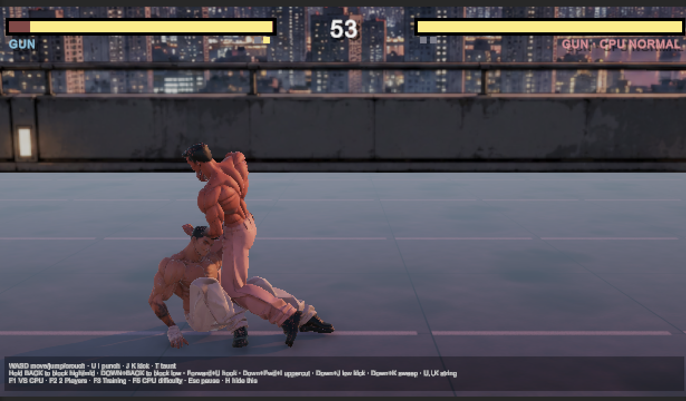

# Lookism Fighter

A 2.5D Tekken-style fighting game prototype with a manga look, built in **Unity 6** (6000.6.7f1, Universal Render Pipeline).

Fighters are full 3D characters, but they move on a single 2D plane and always face each other, like Tekken or Street Fighter 6.

**[▶ Play in your browser](https://tenzin3.github.io/LookismFighter/)** (desktop: keyboard or gamepad · phone: touch controls, hold it sideways)

## Made with AI tools

| Part | Tool |
|---|---|
| Character concept art (the front-view illustration) and the rooftop sunset background | [ChatGPT](https://chatgpt.com) image generation |
| 3D model from the character image | [Triverse](https://triverse.ai) |
| Skeleton (rigging) and all animations | [Mixamo](https://www.mixamo.com) |
| All game code: fighting system, controls, CPU opponent, camera, rounds and HUD, generated sound effects and music, and the one-click editor setup tools | [Claude](https://claude.ai) (Anthropic) |
| Engine | [Unity 6](https://unity.com) |

## How the character was made

The fighter (`Assets/Characters/gun.fbx`) was made in three steps, without hand-modelling or hand-animating.

### 1. 3D model from a single image — [Triverse](https://triverse.ai)

- We started from one **front-view character illustration**, generated with **ChatGPT**: full body, A-pose with arms away from the body, plain white background.
- Triverse's **HD Mesh → Image** tool turned that image into a textured 3D model.
- Settings used: **Polycount 50K**, **Open texture ON**, Multi View off, Ultra Mesh Quality off.
- Exported as **FBXZ** (an FBX plus a `texture/` folder with `albedo.jpg`, `roughness.jpg` and `metallic.jpg`).

### 2. Skeleton (rigging) and animations — [Mixamo](https://www.mixamo.com)

Mixamo is responsible for **joining the model to a skeleton** and for **all of the animations**.

- **Auto-rigging:** the mesh was uploaded to Mixamo's Auto-Rigger as a zipped OBJ with its texture. Markers were placed on the chin, wrists, elbows, knees and groin, using the **Standard Skeleton (65)**. Mixamo built the bone structure and skin weights that let the body bend.
- **Character download:** FBX Binary, **T-pose** (the pose Unity's Humanoid setup expects).
- **Animations:** 21 moves applied to the rigged character and downloaded as **FBX for Unity, Without Skin, 30 FPS, no keyframe reduction**, with **In Place** turned on wherever Mixamo supports it.

| Group | Files in `Assets/Animations/` |
|---|---|
| Stance & movement | `fighting_idle`, `step_forward`, `step_backward`, `crouch_idle`, `jump` |
| Punches | `jab`, `cross`, `hook`, `uppercut` |
| Kicks | `side_kick`, `roundhouse_kick`, `low_kick`, `leg_sweep` |
| Defence | `block_high`, `block_low` |
| Getting hit | `head_hit`, `stomach_hit`, `knocked_down`, `getting_up` |
| Round flow | `victory`, `taunt` |

### 3. Unity setup

- `gun.fbx`: Rig → **Humanoid** (avatar created from the model). Textures extracted, and a URP Lit material (`Assets/Characters/Materials/skinmat`) uses `albedo.jpg` as its Base Map.
- Every animation: Rig → **Humanoid**, **Copy From Other Avatar** (gun's avatar), so all moves play on the same skeleton.
- Looping clips: `fighting_idle`, `step_forward`, `step_backward`, `crouch_idle`, `block_high`, `block_low`.
- Root motion **baked into pose** (rotation, Y and XZ) on all clips, so movement is driven by game code rather than by the animations.
- `Assets/Animations/FighterAnimator.controller` has `fighting_idle` as its default state and is assigned to the character in `SampleScene`.

## The stage

- The rooftop sunset background (`Assets/Stage/rooftop_sunset.png`) was generated with **ChatGPT**.
- **Tools → Lookism Fighter → Apply Rooftop Sunset Stage** places it as a large backdrop behind the fight, builds a wet-concrete 3D floor that meets the painted railing, adds a reflection probe so the floor mirrors the city, and sets warm sunset lighting.

## Playing

Run **Tools → Lookism Fighter → Setup Fight Scene** once, then press Play.

| Action | Keys |
|---|---|
| Move · jump · crouch | W A S D |
| Punch 1 / 2 | U / I |
| Kick 3 / 4 | J / K |
| Block high/mid · block low | hold back · hold down + back |
| Hook · uppercut | forward + U · down + forward + I |
| Low kick · leg sweep | down + J · down + K |
| VS CPU · 2 players · training | F1 · F2 · F3 |
| CPU difficulty · pause · help | F5 · Esc · H |

All fight tuning (game speed, damage, reach, camera) is in `FightConfig` and `MoveTable` in `Assets/Scripts/MoveTable.cs`.

## Adding another fighter

1. Make a front-view, A-pose, white-background image of the new character.
2. Generate the model in Triverse (HD Mesh, 50K, texture on) and export it as FBXZ.
3. Upload it to Mixamo, auto-rig it, and download it in T-pose.
4. Import it into `Assets/Characters` and set it to Humanoid. The existing animations can be reused through Unity's Humanoid retargeting.

## Web build (GitHub Pages)

The playable web version lives in `docs/` and is published by GitHub Pages (Settings → Pages → Deploy from branch `main`, folder `/docs`).

To update it: **File → Build Profiles → Web → Build**, choose the `docs` folder (lowercase), then commit and push. Publishing settings: Compression Format **Gzip**, **Decompression Fallback on**. `docs/.nojekyll` stops GitHub from processing the files, and `.gitattributes` keeps `docs/` out of Git LFS because Pages cannot serve LFS files.

## Repository notes

- Large binary files (`.fbx`, `.jpg` and so on) are stored with **Git LFS**. Install it before cloning: `brew install git-lfs && git lfs install`.
- `Library/`, `Temp/`, `Logs/` and `UserSettings/` are generated by Unity and are not committed.

## Credits

- Character concept art and background: [ChatGPT](https://chatgpt.com)
- 3D model generation: [Triverse](https://triverse.ai)
- Rigging and animations: [Mixamo](https://www.mixamo.com) (Adobe)
- Game code: [Claude](https://claude.ai) (Anthropic)
- Engine: [Unity](https://unity.com)

Check the current terms of use of ChatGPT, Triverse and Mixamo before publishing or selling the game.
